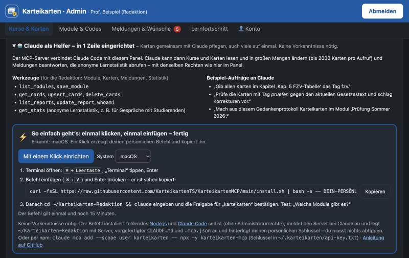

# Karteikarten-MCP

MCP-Server für das Karteikartensystem der TÜV SÜD Akademie (Prototyp). Mit ihm kann
[Claude Code](https://docs.claude.com/en/docs/claude-code/setup) Module, Karten und Meldungen im
Admin-Panel lesen und pflegen, auch in großen Mengen.

> **Nur für die eigene Anwendung im Karteikartensystem.** Keine Weitergabe, keine Nutzung für andere
> Zwecke – siehe [LICENSE](LICENSE). Ohne persönlichen Zugang zum Panel funktioniert der Server nicht.

## In einer Zeile eingerichtet – ganz ohne Vorkenntnisse

Installiert alles, was fehlt (Node.js, Claude Code, MCP-Server), ohne Administratorrechte, und meldet
den Server bei Claude Code an. Am Ende fragt das Skript nach deinem Einrichtungs-Befehl aus dem Panel
(„Karteneditor“ → „Claude als Helfer“ → „Mit einem Klick einrichten“).

**macOS / Linux** – Terminal öffnen (Mac: <kbd>⌘</kbd>+<kbd>Leertaste</kbd>, „Terminal“), einfügen, Enter:

```bash
curl -fsSL https://raw.githubusercontent.com/KarteikartenTS/KarteikartenMCP/main/install.sh | bash
```

**Windows** – PowerShell öffnen (<kbd>Win</kbd>+<kbd>X</kbd> → „Terminal“), einfügen, Enter:

```powershell
irm https://raw.githubusercontent.com/KarteikartenTS/KarteikartenMCP/main/install.ps1 | iex
```

### Wo finde ich meinen Code?

Im Admin-Panel anmelden → Tab **„Karteneditor“** → Bereich **„Claude als Helfer“** → Knopf
**„Mit einem Klick einrichten“**. Der Befehl mit deinem persönlichen Code wird sofort kopiert – du musst ihn
nur noch im Terminal einfügen.



### Was macht das?

Ganz einfach erklärt – das Programm erledigt alles von selbst, Schritt für Schritt:

1. **Es schaut nach, was fehlt.** Was schon da ist, wird nicht noch einmal installiert.
2. **Es holt die nötigen Helfer:** „Node.js“ (damit die Verbindung läuft) und „Claude Code“
   (der Assistent). Beides kommt direkt vom Hersteller.
3. **Es richtet die Verbindung zu den Karteikarten ein** und legt einen Ordner
   „Karteikarten-Redaktion“ an. Darin arbeitest du später.
4. **Es fragt einmal nach deinem Code** aus dem Panel. Den einfach einfügen und Enter drücken.
5. **Es prüft, ob alles klappt,** und zeigt am Ende deinen Namen und „Fertig!“.

Gut zu wissen:

- Du brauchst **kein Administrator-Passwort**. Am Computer wird nichts verstellt.
- Es dauert ein paar Minuten. Einfach warten, bis „Fertig!“ erscheint.
- Geht etwas schief, steht dort in Rot, was zu tun ist. Du kannst die Zeile jederzeit noch einmal
  einfügen – das schadet nicht und bringt alles auf den neuesten Stand.

**Danach:** ein neues Fenster öffnen, `cd ~/Karteikarten-Redaktion` eingeben, Enter, dann `claude`
eingeben, Enter. Beim ersten Mal meldest du dich bei Claude an. Dann z. B. fragen:
„Welche Module gibt es?“

Noch einfacher: Der Knopf im Panel kopiert dieselbe Zeile gleich mit deinem persönlichen Code –
dann entfällt Schritt 4.

## Wer darf was?

| Zugang | Schlüssel | Werkzeuge |
|---|---|---|
| Redaktion (Professoren, Lektorat) | persönlicher API-Schlüssel `edk-…` aus dem Panel | `whoami`, `list_modules`, `save_module`, `get_cards`, `upsert_cards`, `delete_cards`, `get_card_history`, `list_reports`, `get_requests`, `propose_answer`, `approve_answer`, `update_report`, `get_stats` (anonyme Lernstatistik) |
| Admin | Admin-Schlüssel | zusätzlich Freischalt-Codes, Modul löschen |

Der Server zeigt nur die Werkzeuge an, die dein Zugang benutzen darf. Jede Änderung landet mit deinem
Namen und Grund in der Korrekturhistorie der Karte.

## Einrichten

**Am einfachsten:** Im Panel anmelden → Tab „Karteneditor“ → „Claude als Helfer“ →
**„Mit einem Klick einrichten“**. Der kopierte Befehl legt `~/Karteikarten-Redaktion` mit Server,
`CLAUDE.md` und `.mcp.json` an und hinterlegt deinen Schlüssel.

**Manuell** (Voraussetzungen: Claude Code und Node.js ab Version 18):

1. Dieses Repo herunterladen (Code → Download ZIP) oder klonen.
2. Im Panel einen API-Schlüssel erzeugen und in `~/.karteikarten/api-key.txt` speichern
   (Windows: `%USERPROFILE%\.karteikarten\api-key.txt`).
3. Server anmelden:
   ```bash
   claude mcp add --scope user karteikarten -- node /Pfad/zu/KarteikartenMCP/server.js
   ```
   oder im Projektordner `.mcp.json.example` nach `.mcp.json` kopieren.
4. `claude` starten, mit `/mcp` prüfen und z. B. fragen: „Welche Module gibt es?“

Die `CLAUDE.md` erklärt Claude den Kartenaufbau (IDs behalten, Vorschau vor dem Speichern, Grund
angeben, Tag `korrigiert`). Lege sie in den Ordner, in dem du Claude startest.

## Konfiguration

| Variable | Bedeutung |
|---|---|
| `KARTEIKARTEN_ADMIN_TOKEN_FILE` | Pfad zu einer Datei mit dem Schlüssel |
| `KARTEIKARTEN_ADMIN_URL` | Panel-Adresse, Standard `https://karteikarten-admin.pages.dev` |

Den Schlüssel nie in Chats, Dateien im Repo oder Screenshots weitergeben. Im Panel kannst du ihn
jederzeit widerrufen („Zugriff für Claude widerrufen“).
